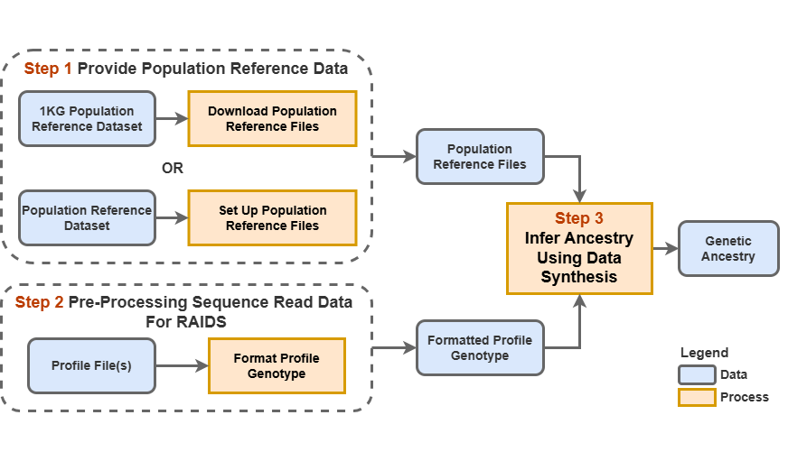
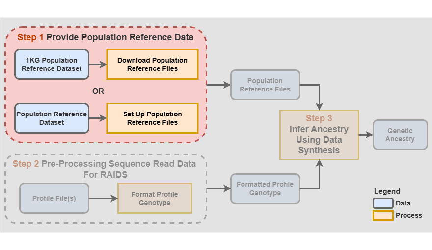

```{r style, echo=FALSE, results='hide', warning=FALSE, message=FALSE}
BiocStyle::markdown()

suppressPackageStartupMessages({
    library(knitr)
    library(RAIDS)
})

set.seed(121444)
```

<br>
**Package**: `r Rpackage("RAIDS")`<br>
**Authors**: `r packageDescription("RAIDS")[["Author"]]`<br>
**Version**: `r packageDescription("RAIDS")$Version`<br>
**Compiled date**: `r Sys.Date()`<br>
**License**: `r packageDescription("RAIDS")[["License"]]`<br>


<br>

# Licensing 

The **RAIDS** package and the underlying **RAIDS** code are distributed 
under the 
[Apache License 2.0](https://opensource.org/licenses/Apache-2.0 "Apache License 2.0"). 
You are free to use and redistribute this software.  

<br>
<br>

# Citing

If you use the **RAIDS** package for a publication, we would ask you to cite 
one of the following.

If you use a more recent version (Bioconductor release 3.24 or later):

> Pascal Belleau, Xintong Li, Astrid Deschênes, Laine Marrah, Alexander Krasnitz. A versatile set of computational tools for inference of genetic ancestry from human molecular data. 
bioRxiv 2026.10.09.758080; doi: https://doi.org/10.64898/2026.10.09.758080

If you use the legacy version (Bioconductor release 3.23 or earlier):

> Pascal Belleau, Astrid Deschênes, Nyasha Chambwe, David A. Tuveson, Alexander Krasnitz; Genetic Ancestry Inference from Cancer-Derived Molecular Data across Genomic and Transcriptomic Platforms. Cancer Res 1 January 2023; 83 (1): 49–58. https://doi.org/10.1158/0008-5472.CAN-22-0682


<br>
<br>

# Introduction

The **RAIDS** (**R**obust **A**ncestry **I**nference using **D**ata 
**S**ynthesis) package enables accurate and robust inference of genetic 
ancestry from human molecular data other than whole-genome or whole-exome 
sequences of cancer-free DNA. The current version can handle sequences of:

* whole genomes
* whole exomes
* targeted gene panels 
* RNA-Seq
* scRNA-Seq 
* ATAC-Seq
* ChIP-Seq

including those from cancer-derived nucleic acids. The **RAIDS** package 
implements a data synthesis method that, for any given
molecular profile of an individual, enables, on the one hand, profile-specific 
inference parameter optimization and, on the other hand, a profile-specific 
inference accuracy estimate. By the molecular profile we mean a table of the 
individual's germline genotypes at genome positions with sufficient read 
coverage in the individual's input data, where sequence variants are frequent 
in the population reference data. 

In addition, the **RAIDS** package can now infer both global ancestry and 
admixture proportions of the individual.

<br>
<br>

# Installation

To install this package 
from [Bioconductor](https://bioconductor.org/packages/RAIDS), start R 
(version 4.3 or later) and enter: 


```{r installDemo01, eval=FALSE, warning=FALSE, message=FALSE}
if (!requireNamespace("BiocManager", quietly = TRUE))
        install.packages("BiocManager")

BiocManager::install("RAIDS")
```

<br>
<br>


# Using RAIDS: step-by-step explanation

This is an overview of the **RAIDS** inferential framework:

```{r graphMainSteps, echo=FALSE, fig.align="center", fig.cap="An overview of the genetic ancestry inference procedure.", out.width='130%', results='asis', warning=FALSE, message=FALSE}

```

The main steps are:

**Step 1.** Set up working directory and provide population reference files

**Step 2.** Pre-process sequence read data into a profile genotype file

**Step 3.** Infer genetic ancestry

**Post-Analysis.** Summarize and visualize the results

These steps are described in detail in the following. 

<br>
<br>


## Step 1. Set up working directory and provide population reference files


### 1.1 Create a working directory structure

First, the following working directory structure should be created:

```

#############################################################################
## Working directory structure
#############################################################################
workingDirectory/  
	data/  
		refGDS/  
		profileGDS/ 

```

<br>

The following code creates a temporary working directory structure where the 
example will be run. 


```{r createDir, echo=TRUE, eval=TRUE, collapse=TRUE, warning=FALSE, message=FALSE}

#############################################################################
## Create a temporary working directory structure
##    using the tempdir() function
#############################################################################
pathWorkingDirectory <- file.path(tempdir(), "workingDirectory")
pathWorkingDirectoryData <- file.path(pathWorkingDirectory, "data")

if (!dir.exists(pathWorkingDirectory)) {
        dir.create(pathWorkingDirectory)
        dir.create(pathWorkingDirectoryData)
        dir.create(file.path(pathWorkingDirectoryData, "refGDS"))
        dir.create(file.path(pathWorkingDirectoryData, "profileGDS"))
}

```

<br>

### 1.2 Download the population reference files


The **population reference files** should be downloaded into the *data/refGDS* 
sub-directory. The following code downloads the complete pre-processed files 
for 1000 Genomes (1KG), for the hg38 build of the human genome, in the GDS 
format. The size of the 1KG GDS file is 15GB. 

```

#############################################################################
## How to download the pre-processed files for 1000 Genomes (1KG) (15 GB)
#############################################################################
cd workingDirectory
cd data/refGDS

wget https://labshare.cshl.edu/shares/krasnitzlab/RAIDSpopRef/v0.2.0/matGeno1000gV0.2.0.gds
wget  https://labshare.cshl.edu/shares/krasnitzlab/RAIDSref/v0.2.0/matAnnot1000gV0.2.0.gds
cd -

```

<br>


For illustrative purposes, a small **population reference GDS file** (called _ex1_good_small_1KG.gds_) and a small 
**population reference SNV Annotation GDS file** (called 
_ex1_good_small_1KG_Annot.gds_) are 
included in this package. Please note that these "mini-reference" files are 
for illustrative purposes only and cannot be used to infer genetic ancestry 
reliably.

In this example, the mini-reference files are copied to the 
*data/refGDS* directory.

```{r copyRefFile, echo=TRUE, eval=TRUE, collapse=TRUE, warning=FALSE, message=FALSE}

#############################################################################
## Load RAIDS package
#############################################################################
library(RAIDS)   

#############################################################################
## The population reference GDS file and SNV Annotation GDS file
##    need to be located in the same sub-directory.
## Note that the mini-reference GDS file used for this example is
##    NOT sufficient for reliable inference.
#############################################################################
## Path to the demo 1KG GDS file is located in this package
dataDir <- system.file("extdata", package="RAIDS")
pathReference <- file.path(dataDir, "tests")

fileGDS <- file.path(pathReference, "ex1_good_small_1KG.gds")
fileAnnotGDS <- file.path(pathReference, "ex1_good_small_1KG_Annot.gds")

## The 'pathWorkingDirectoryData' variable has been set in a previous step
file.copy(fileGDS, file.path(pathWorkingDirectoryData, "refGDS"))
file.copy(fileAnnotGDS, file.path(pathWorkingDirectoryData, "refGDS"))

```

<br>

### 1.3 Install ADMIXTURE for admixture proportion inference

If you plan to infer admixture proportions, you need to install 
ADMIXTURE version 1.3.0 or later (earlier versions may work but have not 
been tested) [@Alexander2009]. You can download it from:
https://dalexander.github.io/admixture/download.html

Example for Linux and Mac:
```

#############################################################################
## How to download and install the ADMIXTURE software
#############################################################################
cd workingDirectory
mkdir admixture
cd admixture

wget https://dalexander.github.io/admixture/binaries/admixture_linux-1.4.0.tar.gz
tar -xzvf admixture_linux-1.4.0.tar.gz
ADMIX=$(pwd)/admixture_linux-1.4.0/admixture

# For Mac:
# wget https://dalexander.github.io/admixture/binaries/admixture_macosx-1.3.0.tar.gz
# tar -xzvf admixture_macosx-1.3.0.tar.gz
# export ADMIX=$(pwd)/dist/admixture_macosx-1.3.0/admixture
cd -

```

<br>
<br>

## Step 2. Pre-process sequence read data into a profile genotype file

A formatted profile genotype file, associated with the sample whose genetic 
ancestry will be inferred, is required as input to **RAIDS**.

The genotype file can be in a VCF format, with the following 
mandatory fields: _GT_, _AD_ and _DP_. The VCF file must be gzipped.

Also allowed is a "generic" file format, specified 
as a comma-separated table. The following columns are mandatory:

* _Chromosome_: The name of the chromosome can be formatted as chr1 or 1
* _Position_: The position on the chromosome
* _Ref_: The reference nucleotide
* _Alt_: The alternative nucleotide
* _Count_: The total read count
* _File1R_: Read count for the reference nucleotide
* _File1A_: Read count for the alternative nucleotide
 
Note: a header with identical column names is required.

For demonstration purposes, the **RAIDS** package includes a SNP VCF file 
generated from a DNA sequencing profile.

```{r step2, echo=TRUE}

## Path to the demo files inside this package
dataDir <- system.file("extdata", package="RAIDS")

#######################################################################
## The demo SNP VCF file of the DNA profile donor
#######################################################################
fileDonorVCF <- file.path(dataDir, "example", "snpPileup", "ex1.vcf.gz")

```

<br>
<br>

## Step 3. Ancestry inference with RAIDS

### 3.1 Define the input file paths

All required directories have been created in Step 1. The paths to 
the reference files should be stored in variables for later use.

```{r defineFilePaths, echo=TRUE, eval=TRUE, collapse=TRUE, warning=FALSE, message=FALSE}

#############################################################################
## The file path to the population reference GDS file 
##     is required (refGenotype will be used as input later)
## The file path to the population reference SNV Annotation GDS file
##     is also required (refAnnotation will be used as input later)
#############################################################################
pathReference <- file.path(pathWorkingDirectoryData, "refGDS")

refGenotype <- file.path(pathReference, "ex1_good_small_1KG.gds")
refAnnotation <- file.path(pathReference, "ex1_good_small_1KG_Annot.gds")

#############################################################################
## The output profileGDS directory, inside workingDirectory/data, must be 
##    created (pathProfileGDS will be used as input later)
#############################################################################
pathProfileGDS <- file.path(pathWorkingDirectoryData, "profileGDS")

if (!dir.exists(pathProfileGDS)) {
    dir.create(pathProfileGDS)
}

```

<br>

### 3.2 Infer genetic ancestry

Within a single function call, data synthesis is performed, the synthetic 
data are used to optimize the inference parameters and, with these, the 
ancestry is inferred from the input sequence profile.

The function to infer categorical ancestry is *ancestryInferencePCAKNN()*. 

The parameters for **RAIDS** are now all kept in a *RAIDSparam* object.

The principal parameters are:

* *profileFile*: The file with the read depth information.
* *genoSource*: The format of file used in the *profileFile* parameter; it can be "VCF", "bam", "generic", or "snp-pileup".
* *pathProfileGDS*: The path where the GDS specific to the profile will be saved.
* *fileReferenceGDS*: The path to the population reference GDS file.
* *fileReferenceAnnotGDS*: The path to the population reference GDS annotation file.
* *studyType*: The valid options are "LD" or "GeneAware"; "LD" is used in the case of DNA and ChIP-Seq, and 
"GeneAware" for RNA-Seq, scRNA-Seq, and ATAC-Seq.

See `?RAIDSparam` for the complete list of parameters.

In this demonstration, the demo SNP VCF profile included in the package 
is used.

```{r inferAncestry, echo=TRUE, eval=TRUE, collapse=TRUE, warning=FALSE, message=FALSE}

###########################################################################
## Seqinfo and BSgenome are required libraries to run this example
###########################################################################
if (requireNamespace("Seqinfo", quietly=TRUE) &&
      requireNamespace("BSgenome.Hsapiens.UCSC.hg38", quietly=TRUE)) {

    #######################################################################
    ## Chromosome length information is required
    ## chr23 is chrX, chr24 is chrY and chrM is chr25
    #######################################################################
    genome <- BSgenome.Hsapiens.UCSC.hg38::Hsapiens
    chrInfo <- Seqinfo::seqlengths(genome)[1:25]

    #######################################################################
    ## The demo SNP VCF file of the DNA profile donor
    #######################################################################
    fileDonorVCF <- file.path(dataDir, "example", "snpPileup", "ex1.vcf.gz")

    #######################################################################
    ## The parameter object required to run the ancestry inference
    #######################################################################
    paramRAIDS <- RAIDSparam(profileFile=fileDonorVCF,
        genoSource="VCF",
        studyType="LD",
        pathProfileGDS=pathProfileGDS,
        fileReferenceGDS=refGenotype,
        fileReferenceAnnotGDS=refAnnotation,
        chrInfo=chrInfo)

    #######################################################################
    ## The ancestry inference call
    #######################################################################
    resOut <- ancestryInferencePCAKNN(pRAIDS=paramRAIDS)

    #######################################################################
    ## The admixture proportions inference
    ## you have to uncomment this section
    ## and specify the path of ADMIXTURE software
    #######################################################################
    # paramRAIDS <- resOut$pRAIDS
    # pathADMIXTURE(paramRAIDS) <- "PATH/admixture"
    # resAdmixture <- computeAdmixtureProportions(pRAIDS=paramRAIDS)

}

```


The temporary files created in this example are deleted as follows.

```{r removeTmp, echo=TRUE, eval=TRUE, collapse=TRUE, warning=FALSE, message=FALSE}

#######################################################################
## Remove temporary files created for this demo
#######################################################################
unlink(pathWorkingDirectory, recursive=TRUE, force=TRUE)
      
```

<br>
<br>


## Post-Analysis. Examine the output of the inference call

The inferred ancestry and the optimal parameters are present in the *list* 
object generated by the *ancestryInferencePCAKNN()* function.


```{r printRes, echo=TRUE, eval=TRUE, collapse=TRUE, warning=FALSE, message=FALSE}

###########################################################################
## The output is a list object with multiple entries
###########################################################################
class(resOut)
names(resOut)

```


<br>

### Inspect the inference and the optimal parameters


Global ancestry is inferred using principal-component decomposition
followed by nearest-neighbor classification. Two parameters are defined and 
optimized: *D*, the number of top principal directions retained and *k*, 
the number of nearest neighbors.  

The results of the inference are provided as the *Ancestry* item in 
the *resOut* list. It is a *data.frame* with the following columns:

* _sample.id_: The unique identifier of the sample 
* _D_: The optimal *D* inference parameter
* _k_: The optimal *k* inference parameter
* _SuperPop_: The inferred ancestry


```{r print, echo=TRUE, eval=TRUE, collapse=TRUE, warning=FALSE, message=FALSE}

###########################################################################
## The ancestry information is stored in the 'Ancestry' entry 
###########################################################################
print(resOut$Ancestry)

```

<br>

### Visualize the RAIDS performance for the synthetic data


The *createAUROCGraph()* function enables the visualization of RAIDS 
performance for the synthetic data, as a function of *D* and *k*.

```{r visualize, echo=TRUE, eval=TRUE, fig.align="center", fig.cap="Visualization of RAIDS performance for the synthetic data.", results='asis', collapse=FALSE, warning=FALSE, message=FALSE}

###########################################################################
## Create a graph showing the performance for the synthetic data
## The output is a ggplot object
###########################################################################
createAUROCGraph(dfAUROC=resOut$paraSample$dfAUROC, title="Example ex1")

```

In this illustrative example, the performance estimates are lower than would 
be expected with a realistic sequence profile and a complete reference 
population file.

<br>
<br>

# Format population reference dataset (optional)


```{r graphStep1, echo=FALSE, fig.align="center", fig.cap="Provide population reference data", out.width='120%', results='asis', warning=FALSE, message=FALSE}

```


A population reference dataset with known ancestry is required to infer 
ancestry. 

Important reference files, containing formatted information about 
the reference dataset, are required:

- The population reference GDS file
- The population reference SNV Annotation GDS file
- The population reference SNV Retained VCF file (optional)


The formats of those files are described in 
the [Population reference dataset GDS files](Create_Reference_GDS_File.html) 
vignette.

<span style="color:darkred;font-weight:bold">The reference files associated 
with the Cancer Research paper are available. Note that these 
pre-processed files are for 1000 Genomes (1KG), in hg38. The files are 
available here:</span>

<span style="color:red">
[https://labshare.cshl.edu/shares/krasnitzlab/aicsPaper](https://labshare.cshl.edu/shares/krasnitzlab/aicsPaper)
</span>

<span style="color:darkred;font-weight:bold">The size of the 1KG GDS file 
is 15GB.</span>

<span style="color:darkred;font-weight:bold">The 1KG GDS file is mapped to 
hg38 [@Lowy-Gallego2019a].</span>

<span style="color:darkred;font-weight:bold">This section can be skipped if 
you choose to use the pre-processed files.</span>

<br>
<br>

# Acknowledgments

This work was supported by a National Institutes of Health award U01 
CA289357 to AK.

Claude Opus 5.5, through Claude Code, was used to assist with code maintenance
and unit test writing on the supervision of the maintainer.
<br>
<br>

# Session info

Here is the output of `sessionInfo()` in the environment in which this 
document was compiled:

```{r sessionInfo, echo=FALSE}
sessionInfo()
```

<br>
<br>


# References

